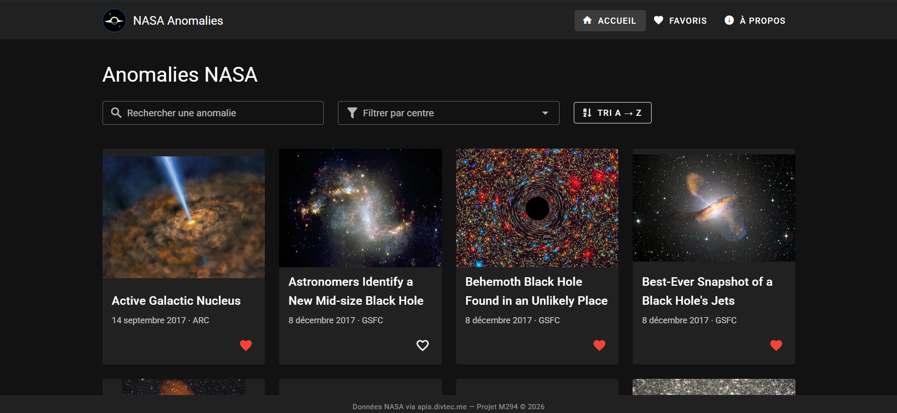

# 🌐 EVENTIDE — Mon Projet Vue.js & Vuetify

## 1. 🎨 Présentation du projet

### Concept
- API choisie : anomalies de la base de données de la NASA (`apis.divtec.me`), données riches (images, dates, centres, mots-clés)  
- Public cible : curieux d’astronomie et d’espace  
- Objectifs de l’application : parcourir les anomalies et consulter le détail de chacune  

### Fonctionnalités principales
- Affichage de la liste des anomalies NASA (via API), sous forme de cartes avec image, date et centre
- Recherche par titre, filtre par centre NASA et tri alphabétique (A → Z / Z → A)
- Vue détail d’une anomalie (description, mots-clés, lien vers NASA Images)
- Favoris : bouton cœur sur chaque carte et page dédiée `/favoris`
- Persistance locale des favoris (`localStorage`)
- États de l’API gérés : chargement (squelettes), erreur (alerte) et résultat vide

### Aperçu visuel
**Application en ligne : [294-projet-nasa-mashdan.vercel.app](https://294-projet-nasa-mashdan.vercel.app/)**

---

## 2. 📚 Parcours d'apprentissage

### Ressources utilisées
#### Documentation & tutos
- [Vue 3 Docs](https://vuejs.org/guide/introduction.html)
- [Vuetify Docs](https://vuetifyjs.com/en/components/all/)
- [Pinia Docs](https://pinia.vuejs.org/)
- [Public APIs List](https://github.com/public-apis/public-apis)
- [Exercice « Pokédex Vuetify » (DEV {JS})](https://devjs.ch/exercices/pokedex-vuetify/) : séquences 1 à 5, transposées au projet NASA
- [Axios Docs](https://axios-http.com/docs/intro)
- [Vue Router Docs](https://router.vuejs.org/)
- [MDN : localStorage](https://developer.mozilla.org/fr/docs/Web/API/Window/localStorage)
- Claude.ai

#### Progression
- Séquence 1 (Étapes 1 à 5) : appel de l’API avec `fetch`, grille responsive, composants `AnomalyCard` / `AppHeader` / `AppFooter`, pages et routes (accueil, à propos, détail dynamique, 404)
- Séquence 2 (Étapes 6 à 8) : store Pinia `anomalyStore` (state, getters, actions), pages connectées au store
- Séquence 3 (Étapes 9 à 11) : Axios, variable d’environnement `VITE_API_URL`, squelettes de chargement et gestion des erreurs
- Séquence 4 (Étapes 12 à 14) : recherche, filtre par centre et tri avec des `computed` chaînés
- Séquence 5 (Étapes 15 à 17) : favoris dans le store, persistance `localStorage`, bouton cœur et page favoris

---

## 3. 🛠️ Outils et méthodologie

### Environnement de développement
- **IDE** : WebStorm
- **Versioning** : Git + GitHub
- **Dépendances principales** : Vue 3, Vuetify 3, Pinia, Axios, Vue Router (routes automatiques)
- **Gestion API Keys** : pas de clé d’API ; l’URL de l’API est dans `.env` (non versionné) + `.env.example`

### Installation & Run
- Cloner le repo : `git clone https://github.com/FilthyMonkeysWhoCantEvenUseJijutsu/294-projet-nasa-mashdan.git`
- Installer : `npm install`
- Lancer : `npm run dev`
- Variables d’environnement : copier `.env.example` → `.env` (contient `VITE_API_URL`, pas de clé secrète)  

### Méthodologie
- Découpage en composants réutilisables
- Props clairement déclarées (`defineProps`) ; la carte est réutilisée sur l’accueil et sur la page favoris
- Store global avec Pinia
- Un commit par étape de l’exercice, avec un message explicite (`feat:` / `docs:`)
- Tests manuels (UI, persistance, erreurs API)

### Choix techniques
- API sélectionnée : NASA Anomalies (`https://apis.divtec.me/api/nasa/anomaly`)  
- Justification du choix : données variées avec images et textes, pas de clé d’API  
- Endpoints utilisés : `GET /api/nasa/anomaly?limit=100&page=N`  
- Limites/quotas connus : l’API contient 179 anomalies, paginées par 100 ; l’application charge toutes les pages au démarrage (2 requêtes) ; aucun quota connu  

### Architecture (Descriptif + schéma simple + data-flow)
- `App.vue` : racine de l’application  
- `layouts/default.vue` : en-tête, contenu et pied de page  
- `pages/` : routes automatiques (`index.vue` avec recherche, filtre et tri, `favoris.vue`, `a-propos.vue`, `anomalies/[id].vue`, `[...path].vue` pour la 404)  
- `components/` : `AppHeader`, `AppFooter` (slot), `AnomalyCard` (props, bouton favori avec `@click.stop.prevent`, snackbar de confirmation)  
- `plugins/axios.js` : instance Axios (`baseURL` lue depuis `VITE_API_URL`)  
- `stores/anomalyStore.js` : store Pinia (state `anomalies`, `isLoading`, `error` ; state `favorites` (IDs) ; getters `totalAnomalies`, `centers`, `getAnomalyById`, `totalFavorites`, `isFavorite`, `getFavorites` ; actions `fetchAnomalies`, `init`, `toggleFavorite`, `loadFavorites`, `saveFavorites`, `cleanupFavorites`)  
- `utils/anomaly.js` : images, dates, nettoyage des textes de l’API  
- `assets/eventide-logo.png` : logo EVENTIDE (en-tête) ; `public/favicon.*` : icône de l’onglet

**Data-flow résumé :**  
- `App.vue` appelle `anomalyStore.init()` au montage → le **store** charge l’API via Axios une seule fois → les pages (liste, détail, favoris) lisent le state et les getters. Les favoris sont rechargés depuis `localStorage` (clé `anomaly_favorites`) dans `init()`, puis sauvegardés à chaque `toggleFavorite`.  
- Page liste : `anomalies` → `filteredByCenter` (`v-select`) → `filteredBySearch` (`v-text-field`) → `sortedAnomalies` (bouton A → Z / Z → A). Ce sont des `computed` chaînés : les données du store ne sont jamais modifiées.

---

## 4. 🧪 Tests et validation

### Tests techniques
- ✅ Appels API fonctionnels  
- ✅ Persistance des favoris vérifiée après refresh (`localStorage`, clé `anomaly_favorites`)  
- ✅ Navigation entre les vues OK  

### Tests d’UX
- Navigation intuitive  
- Recherche/filtre/tri faciles à comprendre  
- Feedback utilisateur (loading, erreurs, vide)  

### Tests d’accessibilité
- Contraste couleurs (Vuetify par défaut)  
- Labels et placeholders corrects  
- Navigation clavier possible  
- Focus visible  

### Tests d’erreurs & fallback
- API down → message d’erreur (`v-alert`) affiché à la place de la grille  
- Chargement → squelettes (`v-skeleton-loader`) affichés pendant la requête  
- Liste vide → message clair affiché (aucun favori : “Vous n'avez pas encore d'anomalies favorites.”)  
- Recherche ou filtre sans résultat → message “Aucune anomalie ne correspond à votre recherche ou à votre filtre.”  

---

## 5. 🤖 Usage d’intelligence artificielle

**⚠️ TRANSPARENCE OBLIGATOIRE** : Si vous utilisez une IA, vous DEVEZ :

### IA utilisée
- **Nom** : Claude
- **Version** : Claude Sonnet 5.5
- **Contexte** : Aide importante de l’IA (voir les pourcentages ci-dessous), création du code étape par étape en suivant l’exercice, debugging et documentation  

### Utilisation détaillée
**Domaines d'aide :**
- Aide au code général : 70%
- Génération de snippets Vue/Vuetify : 50% 
- Aide à la structuration du projet : 20%
- Debugging : 60%
- Recherche d’idées : 40% 

**Compréhension et adaptation**
- Le code a été fait avec l’aide de l’IA en suivant l’exercice « Pokédex Vuetify » (store Pinia, recherche / filtre / tri, favoris avec `localStorage`), dans les proportions indiquées ci-dessus, puis testé par moi dans le navigateur.
- Il a été adapté au projet : anomalies NASA à la place des Pokémon, filtre par centre NASA à la place du filtre par type.

### Parties codées manuellement
- Composants principaux : 20% personnel  
- Store & persistance : 30% personnel  
- Routing & navigation : 30% personnel  
- Tests & validation : 100% personnel  

### Apprentissage personnel
- Ce que j’ai appris grâce à l’IA: à mieux comprendre vue et javascript  
- Comment elle m’a aidé à progresser: Apprendre à utiliser des outils modernes ne fait jamais de mal

---

## 6. 🎯 Bilan personnel

### Ce que j’ai appris
- Compétences techniques acquises : structurer une application Vue 3 / Vuetify avec des composants réutilisables et des pages à routes automatiques ; centraliser les données dans un store Pinia ; appeler une API avec Axios et une variable d’environnement ; filtrer, rechercher et trier avec des `computed` chaînés ; persister des favoris avec `localStorage`.
- Découvertes surprenantes : les données d’une API réelle sont rarement propres (descriptions en HTML, mots-clés dans une seule chaîne, résultats paginés), il faut les nettoyer et les adapter.
- Concepts difficiles maîtrisés : la différence entre `@click.stop` et `.prevent` pour un bouton dans une carte cliquable, et l’ordre de chargement des favoris par rapport à l’API.

### Difficultés rencontrées
- Problèmes techniques et solutions trouvées : l’API renvoie 179 anomalies en 2 pages alors que je n’en chargeais que 100, j’ai donc chargé toutes les pages ; les descriptions HTML ont été nettoyées avec `plainText` et les mots-clés découpés avec `parseKeywords`.
- Moments de blocage et dépassement : j’avais d’abord fait un commit par séquence au lieu d’un commit par étape, j’ai donc refait l’historique Git pour avoir un commit par étape.
- Aide reçue et sources : l’exercice « Pokédex Vuetify » (DEV {JS}), les documentations officielles et l’assistant Claude (voir la section IA).

### Réussites et fiertés
- Aspects du projet dont je suis fier : l’application est en ligne et fonctionne de bout en bout (liste, recherche, filtre, tri, détail, favoris persistants), avec mon propre logo et le nom EVENTIDE.
- Progrès constatés depuis le début : je suis passé d’un simple `fetch` dans une page à une application structurée avec un store, un plugin Axios et des états de chargement et d’erreur.
- Envies de développement futur : ajouter l’authentification et un formulaire d’ajout, puis transformer l’application en PWA.

### Améliorations possibles
- Ce que j’ajouterais avec plus de temps : un défilement infini ou une pagination côté interface pour la liste, et un thème clair / sombre au choix de l’utilisateur.
- Fonctionnalités bonus envisagées : filtre par date ou par mot-clé, page détail enrichie, version mobile (PWA).
- Compétences à approfondir : l’accessibilité, les tests automatisés et le déploiement continu.

---

## 7. 📚 Références & Sources
- Documentation de l’API : [NASA Anomalies (apis.divtec.me)](https://apis.divtec.me/api/nasa/anomaly)  
- Tutos clés utilisés : [Exercice Pokédex Vuetify (DEV {JS})](https://devjs.ch/exercices/pokedex-vuetify/)  
- Usage de l’IA : voir section ci-dessus  
- Autres ressources utiles : [NASA Images](https://images.nasa.gov/) (source des images et des fiches), [Vuetify](https://vuetifyjs.com/), [Pinia](https://pinia.vuejs.org/)
